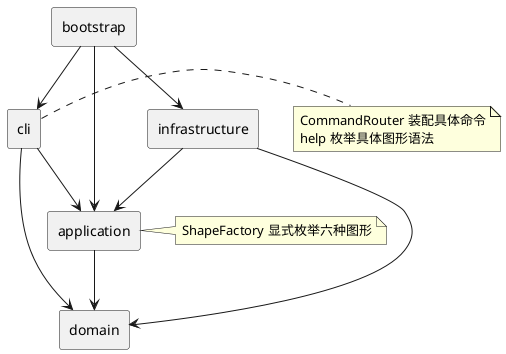
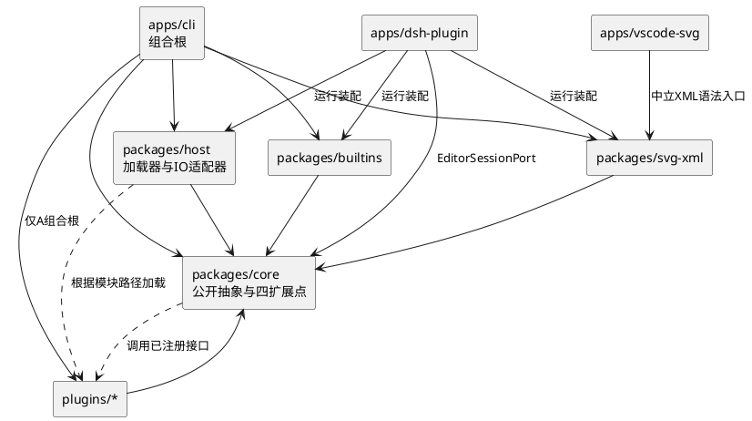

# SVG Editor Platform 架构与接口方案

总体架构方向已确认采用，下文的接口和目标包为实施设计。方案面向 `zero0307/svg-editor-platform`，采用 npm workspaces，沿用 TypeScript、面向对象、Node 内置测试运行器与 Prettier。开发用 Node 版本见[仓库版本文件](../.nvmrc)，CLI 兼容性由 [CI 矩阵](../.github/workflows/ci.yml)验证。

首轮 PR 的拆分、接口交付样例、Phase 1 迁移步骤及冻结条件见[框架实施方案](architecture/framework-implementation.md)。

本方案从 Phase 1 的 `final^{commit}` 开始渐进重构。已核对的基线提交为 `e5621a68afd4731626d54566f17ba55885d1bc0f`。先冻结基线并建立回归，再完成框架通用能力，最后用独立提交接入插件。新增 `box` 或标签时，内核、加载器与既有插件均不再修改。

## 1. 现有代码中值得保留的基础

| 现有位置                                                   | 已有能力                                              | Phase 2 处理方式                                                              |
| ---------------------------------------------------------- | ----------------------------------------------------- | ----------------------------------------------------------------------------- |
| `src/domain/shapes/Shape.ts`、`Group.ts`                   | 封装属性、Composite、公开遍历及多态 `clone()`         | 演进为内核公开领域抽象，区分 SVG 标签与领域类型；增加通用不变量与结构操作契约 |
| `src/domain/SvgDocument.ts`                                | 全局 ID 检查、新增子树检查、文档克隆与校验            | 保留；校验改为每个节点均调用多态不变量，不按图形名字判断                      |
| `src/application/commands/EditCommand.ts`                  | 在脱离当前文档的副本上执行，成功后才形成 before/after | 作为一次编辑事务的基础；禁止通过 SVG 重新解析来制作撤销快照                   |
| `src/application/CommandHistory.ts`                        | 成功后才入栈，失败不清空 redo；文档命令设置屏障       | 保留行为，提供只读状态查询和提交后事件                                        |
| `src/application/SvgEditor.ts`                             | 读入完成后才替换当前文档；保存完成后才设置屏障        | 演进为公开编辑会话服务，供 CLI 和适配器使用                                   |
| `src/application/ShapeFactory.ts`                          | 一个集中式图形工厂                                    | 改成 `ShapeProvider` 注册表；六种具体图形及工厂规则移至 builtins              |
| `src/cli/CommandRouter.ts`                                 | 命令表、解析、帮助及错误输出                          | 拆出通用分发器；具体命令注册移至 builtins，命令自己提供参数规则及帮助         |
| `src/cli/ShapePresenter.ts`                                | 递归树输出与单图形展示                                | 保留无标签输出，再接入统一行尾装饰管线                                        |
| `src/infrastructure/XmlSvgCodec.ts`、`SvgImportContext.ts` | XML、ID 补全、SVG 子集与坐标变换规范化                | 移到 `svg-xml`；解析和语义恢复分开，恢复通过 provider 完成                    |
| `src/infrastructure/LocalFileStore.ts`                     | 文件读写边界与原子保存                                | 保留为宿主适配器；另新增目录读取适配器，不能让插件直接调用文件系统            |
| `scripts/check-architecture.mjs`                           | 依赖方向、一类一文件检查                              | 迁移为跨 workspace 检查，新增包导出边界、禁止插件互相导入、禁止内核依赖插件   |

特别注意：当前 Router 用 `name !== 'init' && name !== 'read' && name !== 'help'` 判断是否需要文档。如果沿用该代码，`dir` 会在未初始化时失败。必须在框架阶段改成命令声明的前置条件，而非继续增加名字例外。

## 2. 包划分与允许依赖

```text
apps/
  cli/                    # REPL、参数入口、A/B 组合根
  vscode-svg/             # VSCode 装饰、Outline、启动与截图验证
  dsh-plugin/             # dsh 协议与工具适配，独立于 CLI 插件生命周期
packages/
  core/                   # 公开领域抽象、四扩展点、注册表、编辑会话与事务
  host/                   # 配置/模块加载、插件注册事务、文件/目录适配器
  svg-xml/                # 中立 XML 语法树、SVG 编解码与导入规范化
  builtins/               # Phase 1 命令及六种图形的默认插件实现
plugins/
  command-stats/          # 独立命令插件
  command-dir/            # 独立命令插件，通过 DirectoryReader 端口访问目录
  shape-box/              # box provider、属性处理器、box 类型标签
  tree-modified/          # modified-star 标签与实例级 dirty 状态
```

包名可采用 `@svgframe/core`、`@svgframe/host`、`@svgframe/svg-xml`、`@svgframe/builtins` 和文档示例中的插件名。目录名与注册名无需一致，例如 `plugins/tree-modified` 注册的 decorator 名为 `modified-star`。每个包用 `exports` 明确公共入口，禁止通过相对路径跨包读取 `src/internal`。TypeScript project references、构建顺序与包 exports 在框架提交中一次建立。

| 模块                    | 可依赖                                                                | 不可依赖                                                        |
| ----------------------- | --------------------------------------------------------------------- | --------------------------------------------------------------- |
| `core`                  | 自身公开/内部领域与应用层；类型定义所需的平台无关抽象                 | host、builtins、plugins、VSCode/dsh API、XML DOM、Node 文件系统 |
| `builtins`、`plugins/*` | core 的公开入口                                                       | core 内部路径、host、apps、其他插件包、Node 文件系统            |
| `svg-xml`               | core 公开端口和抽象、XML 解析库                                       | host、具体图形或命令插件、VSCode API                            |
| `host`                  | core 公开入口、Node 模块/文件系统                                     | 具体可选插件；通用加载器不得硬编码 builtins 或插件名称          |
| `apps/cli`              | host、svg-xml、core、builtins；A 组合根可显式引用可选插件             | 不得把装配逻辑反向导入 core                                     |
| `apps/vscode-svg`       | VSCode API、svg-xml 的中立语法解析入口                                | CLI 入口、命令表、严格文档导入流程                              |
| `apps/dsh-plugin`       | dsh SDK/API、公开编辑服务端口；运行装配时可引用 host/svg-xml/builtins | CLI REPL、文本输出解析、CLI 插件的 `activate` 假定              |

框架对外公布 `Shape`、容器基类、文档只读视图、编辑事务、四扩展点及必要端口。基础几何实现属于 builtins；`box` 不直接导入 `Rect`、`Text`，而是通过公开 `ShapeCreationService` 创建 `rect` 和 `text`。插件测试可提供该服务的替身，独立验证 box，不安装其他插件。默认装配始终提供 Phase 1 能力；“关闭可选插件”不等于删掉默认内置能力。

## 3. 重构前后依赖图

重构前（以当前源码为准）：



目标依赖（实线为源码依赖，虚线为运行时调用/注册）：



可编辑源文件：[Phase 1](architecture/phase1.puml)、[Phase 2 方案](architecture/phase2-proposed.puml)。源码已保存，本轮未渲染 SVG；实现阶段更新为实际依赖并补渲染结果。图中的运行时回调不能被误判为 core 对插件源码的依赖。

## 4. 四扩展点及公共契约

以下名称为接口设计草案，编码前通过契约 PR 固定签名和测试夹具。插件均由类或类实例实现，不能仅注册无归属自由函数。

| 接口               | 主要操作                                                  | 框架调用位置（目标）                      | 无可选实现时                                                                   |
| ------------------ | --------------------------------------------------------- | ----------------------------------------- | ------------------------------------------------------------------------------ |
| `ShapeProvider`    | 类型名/帮助、`create`、SVG 中间节点的 `matches`/`restore` | core 图形创建服务；svg-xml 的语义恢复服务 | 未注册新类型报未知图形；无 box provider 的 `<g data-kind="box">` 按普通 g 恢复 |
| `Command`          | 名称、帮助、参数校验；准备带前置条件及执行效果的调用对象  | core 命令分发器                           | 未加载命令输出 `error: unknown command: <name>`                                |
| `TreeDecorator`    | 对只读树行返回可选后缀；接收提交后的文档事件              | core 树展示服务的行尾装饰管线             | 零后缀，Phase 1 树输出逐字节不变                                               |
| `AttributeHandler` | 稳定注册名、纯 `handles`、候选文档上的 `apply`            | core 属性修改服务，被 Set 编辑事务调用    | 执行目标形状原有属性白名单与多态方法                                           |

正式扩展点清单须再补“实际文件名与函数名、每个实现、违反契约的错误行为与测试”。上表是设计位置，不能作为已完成的验收证据。

provider 使用的 `SvgElementView` 等中立数据接口也定义于 core 公开入口，DOM 到这些接口的适配由 svg-xml 实现；不能让 core 为声明恢复接口反向依赖 XML 包。

建议的属性接口表达如下；`ReadonlyShape` 和 `EditableDocument` 均为 core 公开能力接口，字段保持封装：

```ts
export interface AttributeHandler {
  readonly name: string;
  handles(target: ReadonlyShape, attribute: string): boolean;
  apply(context: AttributeEditContext, request: AttributeRequest): AttributeResult;
}
```

`handles` 只能读取，不能拿到活文档引用。`apply` 的 context 仅能访问本次候选文档，通过公开 `require`、属性设置、容器与形状方法完成修改；返回结果可提供本次领域操作的反馈。优先选择“同时命中两个以上处理器即拒绝”，避免无需求的优先级与组合机制。冲突检测在真正修改前完成。

命令的“命令对象”与“可撤销编辑对象”是不同抽象：`Command` 处理参数和调度请求；`EditCommand`/`EditAction` 描述一次领域编辑。命令准备阶段提供 `requiresDocument` 与 `effect`，分发器依效果路由到只读、编辑、文档、历史上下文，不能按命令名猜测。`canvas` 无参数是只读调用，带参数才是文档屏障；`dir` 无需文档且只获得目录读取端口；`stats` 需要文档只读视图。

`help` 按稳定注册顺序枚举命令，图形参数说明来自 provider。内置顺序固定为 Phase 1 顺序，新插件按装配顺序追加。参数是否允许、参数错误的反馈都由对应命令类负责。

## 5. 一次编辑事务与历史

沿用现有“克隆候选文档 → 修改候选 → 完整校验 → 提交”的策略，适合课程项目，便于验证原子性。不要为此引入数据库或通用事务框架。

1. 解析参数并确认前置条件；取得当前文档的只读引用。
2. 用多态 `clone()` 创建候选文档，保留每种插件图形的实际类型和状态；clone 的形状对象、子节点、样式 Map、父子链接不得与原文档共享可变对象。
3. 在候选文档执行处理器/编辑动作，允许一次动作修改多个子部件。
4. 校验 ID 全局唯一、无循环、父子链接、深度与每个节点的插件不变量。
5. 全部成功后一次替换当前文档、追加一个 undo 单元、清空 redo，最后发出一次提交事件。
6. 任意步骤抛错则丢弃候选；当前文档、当前路径、dirty 基准、屏障和 undo/redo 栈均不动。已命中的处理器失败后不再走默认属性逻辑。

克隆不得使用 `encode`→`decode`：那会混入导入警告、ID 补全、插件缺失降级和 XML 的信息损失。undo/redo 复用已验证的前后快照，不重新运行可能带副作用的处理器。查询拿到的是只读视图；公开 API 不返回可从查询路径修改当前文档的内部对象。

保存和读取保持 Phase 1 屏障规则。`read` 先完整解析/校验，失败不替换当前文档；`save` 完成原子写入后才更新保存基准及屏障，写入失败不清理 dirty。`dir` 成功或失败不建立屏障，也不解开已有屏障；已有 redo 分支不能因查询被清空。命令失败保持全部状态这一约束覆盖内置命令与插件命令。

事件建议仅包括 `documentInitialized`、`documentRead`、`documentSaved`、`editCommitted`、`undoCommitted`、`redoCommitted`、`canvasChanged`，携带只读文档快照和必要前后信息。树标签的事件处理不能抛错破坏已经完成的文档事务；框架捕获并报告装饰器故障，关闭该装饰器并继续使用文档。该策略需配套测试，且禁用标签后不应新增正常路径输出。

## 6. box 在不改内核的情况下成立的前提

内核公开基础形状与容器抽象应在框架阶段提供以下多态能力：

- `kind` 表达领域类型（box），`tag` 表达 SVG 元素标签（g）；容器判定用公开容器能力，不靠名字、`children().length` 或 builtins 的具体类。
- `clone()` 保留实际类型；`validateInvariant()` 对每个节点调用；`canUngroup()`/结构操作策略可在通用操作中拒绝解散或移走必要部件。
- 通用容器插入、移出、删除与分组统一经过结构策略；`ungroup` 先检查复合图形规则，再判断普通顶层分组限制，保证 box 的错误与 Phase 1 §4.4 一致。
- 命令反馈具有公开的多态描述钩子/结果对象：box 的创建、移动和属性修改可以输出其领域摘要，既有命令无需增加 box 分支。默认实现保留 Phase 1 的现有输出；撤销反馈也按原基线约束处理。
- 保留序列化元数据的公开方法，可输出 `data-kind="box"`；克隆与脏状态指纹须包含影响持久化的元数据。

box 内部维护必要子部件的角色与 ID，通过公开形状服务创建 `<id>-rect` 和 `<id>-label`。创建完整新子树后一次交给 `SvgDocument.add` 校验并加入，任何派生 ID 冲突整次失败。两个必要部件在克隆后根据角色/ID重新绑定，不能指向旧快照。

首选结构保护策略：拒绝通过 `delete`、`addto`、`group`、`ungroup` 等普通命令移除或移走 box 的必要部件；允许删除整个 box，允许对必要部件执行合法属性和几何修改，允许增加额外子图形与嵌套 box。通用操作在候选文档执行后还须完整校验，构成第二道保护。整个 box 子树删除时不需要逐个对内部部件触发“单独移除”策略；API 应明确整个子树删除与对子部件的单独移出语义。

读取已安装插件的错误 box 时首选拒绝整个读入，避免默默改变领域语义。缺失必要部件、角色类型错误、重复 ID、循环结构均不能生成不完整 box。未装 box 插件时则使用普通 g provider，保存已有 `data-kind` 元数据并明确说明语义降级；重复 ID 在语义分派前就拒绝，不能通过降级绕过。

box 包一次注册三类贡献：shape `box`、attribute `box-attributes`（处理 fill/label）、decorator `box-type-label`。三个贡献随插件加载事务一起提交或回滚。树中的基准名仍是 `g#id`，`(box)` 由自己的 decorator 提供；不能把标签直接写死在 shape summary 或渲染器里。

## 7. XML 与 VSCode 的复用边界

`svg-xml` 提供两层入口：

1. 中立 XML 语法层：不要求 CLI 白名单、不补 id，不实例化可编辑领域模型，产出元素名、可选 id、子元素与源码范围。Outline 直接使用它，可显示无 id 元素和 CLI 暂不支持的 SVG 标签。不完整 XML 可报告失败并返回空大纲。
2. 严格 SVG 语义层：保留 Phase 1 导入约束、警告、坐标规范化、唯一 ID 及 schema 检查；通过 provider 恢复具体图形。CLI 和 dsh 的 SVG 编辑服务使用这一层。

现有导入器在创建空 Group 后马上对节点施加变换，再读入子节点。box 需要完整子树后才能验证，因此不能简单地在现有 `fromSvg(tag)` 增加 box 特例。框架阶段先构建中立 SVG 中间树：全局预检 ID/命名空间/限制，逐叶规范化变换与继承属性，再以完整子树调用 provider 的恢复接口。明确每片叶子的几何只变换一次；恢复 box 后不能对整个子树再次施加累计变换。

provider 选择由 SVG 标签与元数据匹配，允许普通 g 与标记 box 的特定匹配共存：先选择明确语义标记匹配，再使用标签默认 provider；同一级有多个匹配则拒绝，不按加载先后静默覆盖。没有特定 provider 的未知 `data-kind` 允许标签默认行为；未知 SVG 标签继续保留 Phase 1 的拒绝策略。codec 不得出现 `if (kind === 'box')`。

VSCode 端的 DecorationProvider、DocumentSymbolProvider 和 VSCode `Range` 转换留在 `apps/vscode-svg`。语法层的源码位置统一为偏移与行列约定，VSCode 适配器负责 UTF-16/行列转换和 `selectionRange`，覆盖中文、换行及同一行多个元素；不能只依赖搜索标签文本来定位。语法解析库能否可靠提供源码范围在开工时做小型验证，无法满足时单独实现范围扫描，不让 CLI 模型承担编辑器语法容错职责。

## 8. 标签、dirty 与只读展示

选择“内容与最近一次成功保存/读入的基准不同”语义。新建空文档建立空基准，创建节点立即标记；成功 read 后当前内容为干净基准，成功 save 后更新基准；undo 回到保存点时星号消失。save 后的 undo 屏障仍遵循 Phase 1，验证路径应为“保存 → 编辑 → undo”。

`ModifiedStarDecorator` 实例持有基准指纹 Map、当前差异集合及画布基准，不能使用模块全局变量。指纹来自公开领域投影，包含实际持久化属性、文字、节点身份、父节点与子节点顺序，不包含运行时缓存和界面标签。不以 XML 序列化字符串作指纹，避免缩进或属性输出顺序改变造成误报。相同内容重建与 undo/redo 应得到相同指纹。

选择祖先传播：叶子变化、节点插入/删除或重排会使其祖先及根行出现 `*`。删除节点无法显示自身标签，但保存基准中的旧父链须参与祖先计算。各 decorator 只返回本标签后缀，按稳定注册顺序拼接，每个后缀前一个空格；默认装配 box 标签早于 modified 标签。零标签保留原字节输出，两个标签不互相读取状态。

## 9. A/B 同一路径的加载与回滚

通用加载器位于 host。A 的组合根显式提供模块对象、真实 package manifest 与 options；B 读取配置、解析模块与 package manifest。两种入口最终调用同一个 `PluginInstaller.install`：

```text
模块对象 + manifest + options
        ↓
创建暂存 PluginContext
        ↓
校验默认导出、activate 契约与 manifest 结构
        ↓
顺序执行 activate（仅向暂存区注册）
        ↓
检查全局/本插件内同类注册名重复
        ↓
对四类 contributes 的名称集合逐项比较
        ↓
一次提交注册与所需生命周期状态 → 下一插件
        ↘ 任意失败：丢弃当前暂存区 → 输出对应错误 → 下一插件
```

`activate` 的 context 仅提供注册能力、已校验 options 和公开服务端口；不提供文件系统、活文档或任意持久订阅接口。装饰器事件由成功注册的实例生命周期统一接入，避免激活失败后遗留监听器。若未来引入必须释放的资源，须先把 cleanup 纳入暂存事务，不能只回滚四张注册表就宣称完全回滚。模块顶层要求无外部副作用；此注册事务不承诺撤销第三方模块自行执行的系统操作。

配置插件顺序即加载顺序，`enabled:false` 不解析、不求值、不激活。相对路径以配置文件所在目录为基准，包名按该目录对应运行环境的 Node 解析规则处理，不能改成基于 CLI 当前 SVG 路径。options 作为只读值传入插件工厂/activate，A/B 使用同一传递方式，不通过全局变量读取。

先区分“顶层模块解析不存在”和“已找到模块但求值/依赖失败”：后者属于激活/加载失败，不能简单把所有 `ERR_MODULE_NOT_FOUND` 都报成插件不存在。配置在加载任何可选项前完整校验，结构不合法输出 `error: invalid plugin config`，以默认内置能力继续启动。错误文案及注册清单格式采用实验规定，清单比较按集合但输出排序固定，保证 A/B 字节一致。

加载器目录不导入具体插件，也没有名称映射表；builtin 插件由组合根经过同一安装校验路径装入。A 不允许直接调用裸 `activate` 绕过 Installer。

## 10. 目录适配器与 dsh 边界

`DirectoryReader` 是 core 的公开端口，暴露 `cwd()` 与 `list(path)` 或等价的最小能力。`LocalDirectoryReader` 位于 host，适配 Node `process.cwd()` 和 `fs.readdir({ withFileTypes:true })`，在框架阶段完成；dir接入提交不再新增宿主运行逻辑。dir 插件只拿到该接口，负责直接子项的分类和稳定排序。排序采用大小写敏感的 JavaScript 字符串序比较（`a < b`），避免依赖机器 locale。符号链接显示 `[LINK]`，其余特殊项显示 `[OTHER]`，不跟随链接；顺序固定为目录、普通文件、链接、其他，各组按名称排序。标记与名称之间均为两个空格。包含隐藏项，过滤 `.`、`..`。此扩展标记需要测试，目录和普通文件仍按实验规定显示。

实际 cwd 不因 read/save 或插件配置改变。测试通过端口替身控制失败和条目，通过临时目录验证真实组合；日志在该目录外生成。

dsh 板块单独做“SVG 结构检查/流程图生成”工具插件，初期对 `EditorSessionPort` 使用替身独立开发。接口采用结构化请求/结果，引用公开编辑会话和 codec，不启动 CLI 子进程后解析终端文字。dsh 注册工具与生命周期跟随其官方 API；它不是 CLI PluginModule，不能套用本项目的 contributes 或 activate 形状。外部 API 未验证前不把集成完成写入报告。

## 11. 让各板块独立开发的契约冻结顺序

框架提交先交付公开 `.d.ts`/接口、契约说明、最小替身和测试夹具：形状创建服务、容器结构策略、事务上下文、事件、装饰行上下文、目录端口、PluginModule/manifest。其他板块只导入这些公共入口，不临时从 core 内部取功能。

形状、属性和标签测试可先基于替身并行；VSCode 直接使用中立语法层的固定输入输出；dsh 使用 EditorSessionPort 替身；加载器测试使用专用故障插件。契约变更开独立 PR，列受影响板块并更新调用夹具，避免多个插件 PR 各自修改同一接口。

在框架尚未满足 clone、恢复、结构保护、事件与反馈契约前，box 只在独立分支开发，不能提前以“接入插件”的提交混入框架修补。框架合并后，再用两个演示分支/提交分别证明 A 与 B 的接入差异。指标范围应包括 CLI 的 core、host、svg-xml、builtins、可选插件和 cli app；core 归内核，host/svg-xml/cli app 归宿主装配支撑，builtins/可选插件归插件，迁移表解释与旧目录分类的对应。VSCode/dsh 另列。普通验收证据放 `doc/evidence/`，指标固定放 `docs/metrics/`。

## 12. 应进入 ADR 的决策

- 一次属性设置的处理器冲突拒绝规则、候选文档事务与历史原子性。
- box 读回：无插件降级；装插件但结构不完整拒绝；重复 ID 始终拒绝。
- box 必要部件的结构保护、整棵子树删除的例外语义与 clone 绑定。
- dirty 按内容比较、祖先传播、新节点标记、标签顺序及保存失败行为。
- 清单验证在 activate 暂存后、正式提交前执行；A/B 共用事务。
- 中立 XML 语法层与严格 SVG 语义层分离、完整子树恢复及变换只执行一次。

以上决策先标 Proposed；用实现和测试验证后再改 Accepted。不得把“至少三条 ADR”理解为可以遗漏正文明确要求说明的其他设计取舍。
