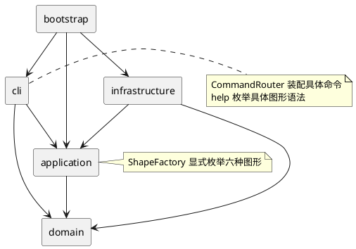
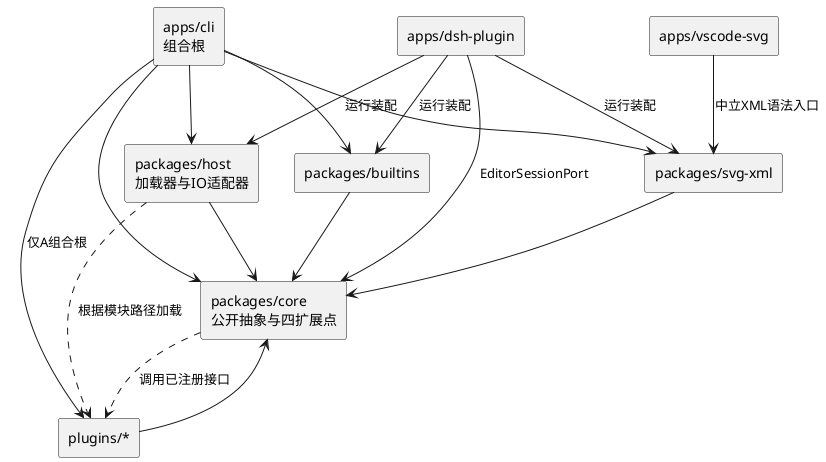

# SVG Editor Platform 架构与接口方案

状态：框架内核、默认命令、严格 codec、宿主加载器与 CLI 已按本方案落地（`packages/core`、`host`、`svg-xml`、`builtins`、`apps/cli`）；旧 `src/` 已在 #14 删除。可选插件中 `stats`（#17）、`dir`（#18）与 `box`（#19）已接入，剩余工作集中在修改标签（#20）、VSCode/dsh 深入集成与验收指标；方案面向 `zero0307/svg-editor-platform`，采用 npm workspaces，保留 TypeScript、面向对象、Node 内置测试运行器与现有 Prettier。

本方案从 Phase 1 的 `final^{commit}` 开始渐进重构。已核对的基线提交为 `e5621a68afd4731626d54566f17ba55885d1bc0f`。先冻结基线并建立回归，再完成框架通用能力，最后用独立提交接入插件。新增 `box` 或标签时，内核、加载器与既有插件均不再修改。

## 1. Phase 1 代码的迁移落点

`src/` 及其分层规则已在 #14 删除；Phase 1 的 89 项回归已迁到根 `test/`，只通过公开包入口运行。具体落点：

| Phase 1 位置                                               | 已有能力                                              | 当前落点                                                                                                 |
| ---------------------------------------------------------- | ----------------------------------------------------- | -------------------------------------------------------------------------------------------------------- |
| `src/domain/shapes/Shape.ts`、`Group.ts`                   | 封装属性、Composite、公开遍历及多态 `clone()`         | `packages/core/domain/Shape.ts`、`ContainerShape.ts`、`Group.ts`；具体图形在 `packages/builtins/shapes/` |
| `src/domain/SvgDocument.ts`                                | 全局 ID 检查、新增子树检查、文档克隆与校验            | `packages/core/domain/SvgDocument.ts`（每节点调用 `validateInvariant()`）                                |
| `src/application/commands/EditCommand.ts`                  | 在脱离当前文档的副本上执行，成功后才形成 before/after | `packages/core/extensions/EditAction.ts` + `services/EditorSession.ts` 的候选文档事务                    |
| `src/application/CommandHistory.ts`                        | 成功后才入栈，失败不清空 redo；文档命令设置屏障       | `packages/core/services/EditHistory.ts`（内部，不向插件开放）                                            |
| `src/application/SvgEditor.ts`                             | 读入完成后才替换当前文档；保存完成后才设置屏障        | `packages/core/services/EditorSession.ts`（公开 `EditorSessionPort`）                                    |
| `src/application/ShapeFactory.ts`                          | 一个集中式图形工厂                                    | `packages/core/services/ProviderShapeCreationService.ts` + `packages/builtins/providers/`                |
| `src/cli/CommandRouter.ts`                                 | 命令表、解析、帮助及错误输出                          | `apps/cli/src/CommandDispatcher.ts` + `packages/builtins/commands/`                                      |
| `src/cli/ShapePresenter.ts`                                | 递归树输出与单图形展示                                | `packages/core/presentation/TreePresenter.ts`                                                            |
| `src/infrastructure/XmlSvgCodec.ts`、`SvgImportContext.ts` | XML、ID 补全、SVG 子集与坐标变换规范化                | `packages/svg-xml/strict/XmlSvgCodec.ts`，恢复通过注册 provider                                          |
| `src/infrastructure/LocalFileStore.ts`                     | 文件读写边界与原子保存                                | `packages/host/adapters/LocalFileStore.ts`；目录读取为 `LocalDirectoryReader`                            |
| `scripts/check-architecture.mjs`                           | 依赖方向、一类一文件检查                              | 跨 workspace 边界检查；旧 `src/` 规则在目录不存在时自动跳过（#14）                                       |

Phase 1 用命令名判断是否需要文档的问题已解决：`Command.prepare` 返回 `requiresDocument`/`effect`，分发器只按元数据路由；测试用 `requiresDocument:false` 的假命令证明未初始化文档可执行，用名为 `read` 但要求文档的查询命令证明不存在名称例外。

## 2. 包划分与允许依赖

```text
apps/
  cli/                    # REPL、参数入口、A/B 组合根
  vscode-svg/             # VSCode 装饰、Outline、启动与截图验证
  dsh-plugin/             # dsh 协议与工具适配，独立于 CLI 插件生命周期
packages/
  core/                   # 公开领域抽象、四扩展点、注册表、编辑会话与事务
  host/                   # 配置/模块加载、插件注册事务、文件/目录适配器
  svg-xml/                # 中立 XML 语法树、SVG 编解码与导入规范化
  builtins/               # Phase 1 命令及六种图形的默认插件实现
plugins/
  command-stats/          # 独立命令插件
  command-dir/            # 独立命令插件，通过 DirectoryReader 端口访问目录
  shape-box/              # box provider、属性处理器、box 类型标签
  tree-modified/          # modified-star 标签与实例级 dirty 状态
```

包名可采用 `@svgframe/core`、`@svgframe/host`、`@svgframe/svg-xml`、`@svgframe/builtins` 和文档示例中的插件名。目录名与注册名无需一致，例如 `plugins/tree-modified` 注册的 decorator 名为 `modified-star`。每个包用 `exports` 明确公共入口，禁止通过相对路径跨包读取 `src/internal`。TypeScript project references、构建顺序与包 exports 已建立；当前实际包为 `core`、`svg-xml`、`host`、`builtins`、`apps/cli`、`apps/vscode-svg`、`apps/dsh-plugin` 与 `plugins/command-stats`（#17）、`plugins/command-dir`（#18）、`plugins/shape-box`（#19）、`plugins/tree-modified`（#20）。

| 模块                    | 可依赖                                                                | 不可依赖                                                        |
| ----------------------- | --------------------------------------------------------------------- | --------------------------------------------------------------- |
| `core`                  | 自身公开/内部领域与应用层；类型定义所需的平台无关抽象                 | host、builtins、plugins、VSCode/dsh API、XML DOM、Node 文件系统 |
| `builtins`、`plugins/*` | core 的公开入口                                                       | core 内部路径、host、apps、其他插件包、Node 文件系统            |
| `svg-xml`               | core 公开端口和抽象、XML 解析库                                       | host、具体图形或命令插件、VSCode API                            |
| `host`                  | core 公开入口、Node 模块/文件系统                                     | 具体可选插件；通用加载器不得硬编码 builtins 或插件名称          |
| `apps/cli`              | host、svg-xml、core、builtins；A 组合根可显式引用可选插件             | 不得把装配逻辑反向导入 core                                     |
| `apps/vscode-svg`       | VSCode API、svg-xml 的中立语法解析入口                                | CLI 入口、命令表、严格文档导入流程                              |
| `apps/dsh-plugin`       | dsh SDK/API、公开编辑服务端口；运行装配时可引用 host/svg-xml/builtins | CLI REPL、文本输出解析、CLI 插件的 `activate` 假定              |

框架对外公布 `Shape`、容器基类、文档只读视图、编辑事务、四扩展点及必要端口。基础几何实现属于 builtins；`box` 不直接导入 `Rect`、`Text`，而是通过公开 `ShapeCreationService` 创建 `rect` 和 `text`。插件测试可提供该服务的替身，独立验证 box，不安装其他插件。默认装配始终提供 Phase 1 能力；“关闭可选插件”不等于删掉默认内置能力。

## 3. 重构前后依赖图

重构前（Phase 1 的 `src/`，已在 #14 删除，仅作历史对照）：



目标依赖（实线为源码依赖，虚线为运行时调用/注册）。当前实际依赖已按此图建立：`apps/cli` 只 import core/host/svg-xml/builtins（并按配置经 host loader 加载插件），`builtins` 只依赖 core，core 不依赖任何具体包。



可编辑源文件：[Phase 1](architecture/phase1.puml)、[Phase 2 方案](architecture/phase2-proposed.puml)。源码已保存，本轮未渲染 SVG；实现阶段更新为实际依赖并补渲染结果。图中的运行时回调不能被误判为 core 对插件源码的依赖。

## 4. 四扩展点及公共契约

四个扩展点的契约已以可编译骨架发布于 `@svgframe/core`（[ADR-0003](adr/0003-core-public-contracts.md)，状态 Proposed）。插件均由类或类实例实现，不能仅注册无归属自由函数。下表是目标调用位置；本节点只交付接口、注册表、只读视图与测试替身，事务、编解码、加载与树装饰管线分别在 #7、#13、#8、#10 落地。

| 接口               | 主要操作                                                  | 框架调用位置（目标）                      | 无可选实现时                                                                   |
| ------------------ | --------------------------------------------------------- | ----------------------------------------- | ------------------------------------------------------------------------------ |
| `ShapeProvider`    | 类型名/帮助、`create`、SVG 中间节点的 `matches`/`restore` | core 图形创建服务；svg-xml 的语义恢复服务 | 未注册新类型报未知图形；无 box provider 的 `<g data-kind="box">` 按普通 g 恢复 |
| `Command`          | 名称、帮助、参数校验；准备带前置条件及执行效果的调用对象  | core 命令分发器                           | 未加载命令输出 `error: unknown command: <name>`                                |
| `TreeDecorator`    | 对只读树行返回可选后缀；接收提交后的文档事件              | core 树展示服务的行尾装饰管线             | 零后缀，Phase 1 树输出逐字节不变                                               |
| `AttributeHandler` | 稳定注册名、纯 `handles`、候选文档上的 `apply`            | core 属性修改服务，被 Set 编辑事务调用    | 执行目标形状原有属性白名单与多态方法                                           |

### 4.1 扩展点清单（初版）

契约文件均位于 `packages/core`，公共入口只有包根的 `index.ts`（`exports` → `dist/index.js`）。注册名是稳定字符串：命令用命令名，图形用领域类型名，装饰器与属性处理器用标签/处理器名；注册表拒绝重复名并保持注册顺序。测试位于 `packages/core/test/`。

| 扩展点             | 契约文件                                       | 稳定注册名 | 注册表                     | 本节点测试                                     | 未完成部分                                             |
| ------------------ | ---------------------------------------------- | ---------- | -------------------------- | ---------------------------------------------- | ------------------------------------------------------ |
| `ShapeProvider`    | `packages/core/extensions/ShapeProvider.ts`    | `type`     | `ShapeProviderRegistry`    | 创建、匹配、恢复、重复与缺省注册               | 无（`box` #19 已接入）                                 |
| `Command`          | `packages/core/extensions/Command.ts`          | `name`     | `CommandRegistry`          | 四种 effect 路由、前置条件、失败不改状态       | 无（`stats` #17、`dir` #18 已接入）                    |
| `TreeDecorator`    | `packages/core/extensions/TreeDecorator.ts`    | `name`     | `TreeDecoratorRegistry`    | 后缀拼接、零后缀字节不变、故障隔离             | 无（`box-type-label` #19、`modified-star` #20 已接入） |
| `AttributeHandler` | `packages/core/extensions/AttributeHandler.ts` | `name`     | `AttributeHandlerRegistry` | 纯 `handles`、候选文档 `apply`、冲突与故障契约 | 无（`box-attributes` #19 已接入）                      |

#7 已把命令/属性/结构三部分落为真实服务：`EditorSession`（候选文档事务）、`AttributeEditingService`/`AttributeEditAction` 与 `StructureService`（含四个结构动作）。#10 已把树展示与行尾装饰管线落为 `TreePresenter`（见 [ADR-0005](adr/0005-tree-display-and-decoration.md)）。#14 已把六种图形和 19 条默认命令迁入 `packages/builtins`，并由 `apps/cli` 经同一 `PluginInstaller` 装配（见 [ADR-0006](adr/0006-cli-pluginization-and-composition-roots.md)）。失败原子性、事件与结构策略约定见 [ADR-0004](adr/0004-candidate-transactions-and-structure.md)。

M2 框架冻结（F = `a21f758`）时的**实际**文件/函数、每个实现、无可选实现时的缺省行为与违约错误测试记录在 [扩展点清单](evidence/framework/extension-points.md)。#17–#20 的插件接入以该清单为契约入口；清单没有补齐的通用能力，不在接入提交里改内核。

#17 已接入 `stats`（`plugins/command-stats`）：命令以 `requiresDocument:true` + `effect:'query'` 声明前置条件与只读效果，DFS 用 `kind` 计叶子、用公开 `ContainerShape` 计容器，A 在 `apps/cli/src/main.ts` 显式装入、B 在 `plugins.config.json` 声明，两条路径都经同一 `PluginInstaller`；`core`/`host`/`builtins`/`svg-xml` 零差异。逐条验收与实测输出见 [017-cmd-01](evidence/acceptance/017-cmd-01.md)。

#18 已接入 `dir`（`plugins/command-dir`）：`requiresDocument:false` + `effect:'query'`，只通过 `QueryContext.directories()` 读取 `cwd()` 与直接子项，排序、`[DIR]/[FILE]/[LINK]/[OTHER]` 标记、空目录与失败文案全在插件内，适配器角色与策略见 [dir.md](dir.md)；Phase 1 兼容性回放通过空配置禁用可选插件（`test/fixtures/plugins/no-optional-plugins.json`），golden 未改。逐条验收见 [018-cmd-02](evidence/acceptance/018-cmd-02.md)。

#19 已接入 `box`（`plugins/shape-box`）：一个包原子注册 `box` provider、`box-attributes` 处理器与 `box-type-label` 装饰器；`BoxShape extends Group` 并用派生 ID `<id>-rect`/`<id>-label`、`data-kind="box"`、`canRemoveChild`/`canUngroup` 与 `validateInvariant` 保护结构；`restore` 只按显式标记匹配、拒绝坏结构，未装插件时自动降级为普通 `g` 并保留 `data-kind`。#19 后续框架补丁（[ADR-0017](adr/0017-polymorphic-command-feedback.md)）已补上多态命令反馈，box 输出 `box#n1 created (g#n1 + rect#n1-rect + text#n1-label)`、`cannot ungroup composite shape: <id>`；undo 仍为统一的 `undone: <message>`。逐条验收见 [019-box-01](evidence/acceptance/019-box-01.md)。

调用约定：

- provider 的 `matches` 是纯查询，只声明“显式语义命中”；标签默认恢复由 `defaultTag` 表达，两阶段选择与歧义拒绝在 #13 的 codec 中实现。
- `Command.prepare` 返回 `requiresDocument` 与 `effect`（`query`/`edit`/`document`/`history`）；`edit` 附带一个 `EditAction`，`document`/`history` 附带操作对象；分发器只按元数据路由。`canvas` 无参数是 `query`，带参数是 `document`。
- `EditorSessionPort.document()` 返回只读投影；查询上下文只持有该投影，编辑只能通过 `EditAction` 在候选文档上执行。
- `TreeDecorator.decorate` 只读行上下文；提交后事件经 `EditorEventBus` 分发，观察者异常被隔离并上报。

provider 使用的 `SvgElementView` 等中立数据接口也定义于 core 公开入口，DOM 到这些接口的适配由 svg-xml 实现；不能让 core 为声明恢复接口反向依赖 XML 包。

建议的属性接口表达如下（已按 [ADR-0003](adr/0003-core-public-contracts.md) 发布）；`ReadonlyShape` 和 `EditableDocument` 均为 core 公开能力接口，字段保持封装：

```ts
export interface AttributeHandler {
  readonly name: string;
  handles(target: ReadonlyShape, attribute: string): boolean;
  apply(context: AttributeEditContext, request: AttributeRequest): AttributeResult;
}
```

`handles` 只能读取，不能拿到活文档引用。`apply` 的 context 仅能访问本次候选文档，通过公开 `require`、属性设置、容器与形状方法完成修改；返回结果可提供本次领域操作的反馈。优先选择“同时命中两个以上处理器即拒绝”，避免无需求的优先级与组合机制。冲突检测在真正修改前完成。

命令的“命令对象”与“可撤销编辑对象”是不同抽象：`Command` 处理参数和调度请求；`EditCommand`/`EditAction` 描述一次领域编辑。命令准备阶段提供 `requiresDocument` 与 `effect`，分发器依效果路由到只读、编辑、文档、历史上下文，不能按命令名猜测。`canvas` 无参数是只读调用，带参数才是文档屏障；`dir` 无需文档且只获得目录读取端口；`stats` 需要文档只读视图。`QueryContext` 同时注入只读文档与 `DirectoryReader`（缺失时 `directories()` 报 `directory access is not available`），因此 `dir` 一类 `requiresDocument:false` 的查询在未初始化文档时也能执行，但仍拿不到 session/编辑/历史能力。

`help` 按稳定注册顺序枚举命令，图形参数说明来自 provider。内置顺序固定为 Phase 1 顺序，新插件按装配顺序追加。参数是否允许、参数错误的反馈都由对应命令类负责。

## 5. 一次编辑事务与历史

沿用现有“克隆候选文档 → 修改候选 → 完整校验 → 提交”的策略，适合课程项目，便于验证原子性。不要为此引入数据库或通用事务框架。

1. 解析参数并确认前置条件；取得当前文档的只读引用。
2. 用多态 `clone()` 创建候选文档，保留每种插件图形的实际类型和状态；clone 的形状对象、子节点、样式 Map、父子链接不得与原文档共享可变对象。
3. 在候选文档执行处理器/编辑动作，允许一次动作修改多个子部件。
4. 校验 ID 全局唯一、无循环、父子链接、深度与每个节点的插件不变量。
5. 全部成功后一次替换当前文档、追加一个 undo 单元、清空 redo，最后发出一次提交事件。
6. 任意步骤抛错则丢弃候选；当前文档、当前路径、dirty 基准、屏障和 undo/redo 栈均不动。已命中的处理器失败后不再走默认属性逻辑。

克隆不得使用 `encode`→`decode`：那会混入导入警告、ID 补全、插件缺失降级和 XML 的信息损失。undo/redo 复用已验证的前后快照，不重新运行可能带副作用的处理器。查询拿到的是只读视图；公开 API 不返回可从查询路径修改当前文档的内部对象。

实现落点（#7）：`packages/core/services/EditorSession.ts` 按上述顺序执行事务，内部 `EditHistory` 保存已验证快照且不向插件开放；`read`/`save` 通过公开 `FileStore` 与 `SvgCodec` 端口完成，成功后才替换文档/更新路径/设置屏障并发布事件；任一失败不改变文档、路径、屏障、undo/redo，也不发事件。`document()`/`hasDocument()`/无尺寸 `canvas` 是纯查询，不清 redo、不改屏障。带尺寸的 `canvas` 克隆候选后一次替换并设置屏障。

保存和读取保持 Phase 1 屏障规则。`read` 先完整解析/校验，失败不替换当前文档；`save` 完成原子写入后才更新保存基准及屏障，写入失败不清理 dirty。`dir` 成功或失败不建立屏障，也不解开已有屏障；已有 redo 分支不能因查询被清空。命令失败保持全部状态这一约束覆盖内置命令与插件命令。

事件建议仅包括 `documentInitialized`、`documentRead`、`documentSaved`、`editCommitted`、`undoCommitted`、`redoCommitted`、`canvasChanged`，携带只读文档快照和必要前后信息；事件只在对应步骤成功后发出，观察者故障经事件总线隔离并上报，不允许破坏已提交状态（[ADR-0003](adr/0003-core-public-contracts.md)）。树标签的事件处理不能抛错破坏已经完成的文档事务；框架捕获并报告装饰器故障，关闭该装饰器并继续使用文档。该策略需配套测试，且禁用标签后不应新增正常路径输出。

## 6. box 在不改内核的情况下成立的前提

内核公开基础形状与容器抽象应在框架阶段提供以下多态能力：

- `kind` 表达领域类型（box），`tag` 表达 SVG 元素标签（g）；容器判定用公开容器能力，不靠名字、`children().length` 或 builtins 的具体类。
- `clone()` 保留实际类型；`validateInvariant()` 对每个节点调用；`canUngroup()`/结构操作策略可在通用操作中拒绝解散或移走必要部件。
- 通用容器插入、移出、删除与分组统一经过结构策略；`ungroup` 先检查复合图形规则，再判断普通顶层分组限制，保证 box 的错误与 Phase 1 §4.4 一致。
- 命令反馈具有公开的多态描述钩子/结果对象：box 的创建、移动和属性修改可以输出其领域摘要，既有命令无需增加 box 分支。默认实现保留 Phase 1 的现有输出；撤销反馈也按原基线约束处理。
- 保留序列化元数据的公开方法，可输出 `data-kind="box"`；克隆与脏状态指纹须包含影响持久化的元数据。

box 内部维护必要子部件的角色与 ID，通过公开形状服务创建 `<id>-rect` 和 `<id>-label`。创建完整新子树后一次交给 `SvgDocument.add` 校验并加入，任何派生 ID 冲突整次失败。两个必要部件在克隆后根据角色/ID重新绑定，不能指向旧快照。

首选结构保护策略：拒绝通过 `delete`、`addto`、`group`、`ungroup` 等普通命令移除或移走 box 的必要部件；允许删除整个 box，允许对必要部件执行合法属性和几何修改，允许增加额外子图形与嵌套 box。通用操作在候选文档执行后还须完整校验，构成第二道保护。整个 box 子树删除时不需要逐个对内部部件触发“单独移除”策略；API 应明确整个子树删除与对子部件的单独移出语义。

实现落点（#7）：公开策略是 `Shape.canUngroup()`、`ContainerShape.canRemoveChild(child)`、`ContainerShape.canInsertChild(child)`；`StructureService` 提供 `remove`/`moveTo`/`group`/`ungroup`，并由 `DeleteAction`/`AddToAction`/`GroupAction`/`UngroupAction` 包装成候选文档编辑，命令只能经过这些动作。删除整棵复合图形只检查父容器，删除或移出必要部件由复合容器拒绝，文案为 `cannot remove necessary part: <id>`/`cannot move necessary part: <id>`；`ungroup` 先查复合规则再查 Phase 1 顶层限制，并按 P1 物化继承样式。复合容器必须在最终类型重写 `protected newContainer()`，否则 clone 会退回父类并丢失策略（#19 需遵守）。详见 [ADR-0004](adr/0004-candidate-transactions-and-structure.md)。

命令反馈（#19 后续补丁）：反馈标识统一使用领域 `kind` 而非 SVG `tag`；`Shape.creationParts()` 默认返回 `[]`，复合图形可返回创建出的领域部件，`CreateAction` 在 `… created` 后追加 ` (<part> + …)`。删除/移动/分组/解散与默认属性反馈同样使用 `kind`，六种 builtins 因 `kind === tag` 输出不变；`ungroup` 拒绝复合图形报 `cannot ungroup composite shape: <id>`，普通顶层分组仍报 `cannot ungroup top-level container: <id>`。undo 保持 `undone: <原消息>`，不实现 §6.1B 的示意文案。详见 [ADR-0017](adr/0017-polymorphic-command-feedback.md)。

读取已安装插件的错误 box 时首选拒绝整个读入，避免默默改变领域语义。缺失必要部件、角色类型错误、重复 ID、循环结构均不能生成不完整 box。未装 box 插件时则使用普通 g provider，保存已有 `data-kind` 元数据并明确说明语义降级；重复 ID 在语义分派前就拒绝，不能通过降级绕过。

box 包一次注册三类贡献：shape `box`、attribute `box-attributes`（处理 fill/label）、decorator `box-type-label`。三个贡献随插件加载事务一起提交或回滚。树中的基准名仍是 `g#id`，`(box)` 由自己的 decorator 提供；不能把标签直接写死在 shape summary 或渲染器里。

实现落点（#19）：`plugins/shape-box` 的 `BoxShape`、`BoxProvider`、`BoxAttributeHandler`、`BoxTypeLabelDecorator` 按本节实现，具体模板、派生 ID、结构策略、读回/降级与序列化见 [ADR-0014](adr/0014-box-structure-and-readback.md)。命令反馈多态钩子已由 #19 后续补丁实现（[ADR-0017](adr/0017-polymorphic-command-feedback.md)）：create/move/delete/set 使用领域 `kind` 与复合创建摘要，`ungroup` 输出 `cannot ungroup composite shape: <id>`；undo 仍为 `undone: <原消息>`。

## 7. XML 与 VSCode 的复用边界

`svg-xml` 提供两层入口：

1. 中立 XML 语法层：不要求 CLI 白名单、不补 id，不实例化可编辑领域模型，产出元素名、可选 id、子元素与源码范围。Outline 直接使用它，可显示无 id 元素和 CLI 暂不支持的 SVG 标签。不完整 XML 可报告失败并返回空大纲。
2. 严格 SVG 语义层：保留 Phase 1 导入约束、警告、坐标规范化、唯一 ID 及 schema 检查；通过 provider 恢复具体图形。CLI 和 dsh 的 SVG 编辑服务使用这一层。

中立语法层已落地在 `packages/svg-xml`（#6）：公共入口 `parseSvgSyntax(source)` 返回 `{ ok: true; root } | { ok: false; message }`，元素带 `tag`、原始 `id`、直接文本、子元素与 `outerSpan`/`startTagSpan`/`nameSpan`；偏移统一为 0-based UTF-16 code unit、end 独占，行/列与 VSCode `Range` 转换由 `apps/vscode-svg` 完成。`xmldom` 不提供源码范围，语法层因此使用自写单遍扫描器，不依赖领域模型或 CLI 白名单；未知标签、重复标签、无 id 与同一行多元素都按源码位置保留。开放问题与取舍见 [ADR-0008](adr/0008-neutral-xml-syntax.md)。

严格语义层已落地（#13）：`packages/svg-xml/strict/XmlSvgCodec.ts` 实现 core 的 `SvgCodec`，构造参数只有公开的 `ShapeProviderRegistry`；`SvgImportNormalizer`/`SvgImportContext`/`SvgTransform` 移植 Phase 1 的 ID、警告、世界变换与继承规范化，`SvgRestorer` 先选显式 `matches`、再按 `defaultTag` 回退，同层多命中拒绝，未知标签保留 `unknown shape type: <tag> (is the plugin loaded?)`，未知 `data-kind` 按标签默认恢复并保留属性。decode 顺序为源码/root 预检 → 全局重复 ID 与深度 → 补 ID 警告 → 变换/继承规范化 → 自底向上 provider 恢复完整子树 → `document.validate()`；叶 provider 应用一次世界变换，容器不重复应用。encode 保持 Phase 1 的声明、缩进、属性顺序、转义与末尾换行。详见 [ADR-0012](adr/0012-svg-readback-matching.md)。

现有导入器在创建空 Group 后马上对节点施加变换，再读入子节点。box 需要完整子树后才能验证，因此不能简单地在现有 `fromSvg(tag)` 增加 box 特例。框架阶段先构建中立 SVG 中间树：全局预检 ID/命名空间/限制，逐叶规范化变换与继承属性，再以完整子树调用 provider 的恢复接口。明确每片叶子的几何只变换一次；恢复 box 后不能对整个子树再次施加累计变换。

provider 选择由 SVG 标签与元数据匹配，允许普通 g 与标记 box 的特定匹配共存：先选择明确语义标记匹配，再使用标签默认 provider；同一级有多个匹配则拒绝，不按加载先后静默覆盖。没有特定 provider 的未知 `data-kind` 允许标签默认行为；未知 SVG 标签继续保留 Phase 1 的拒绝策略。codec 不得出现 `if (kind === 'box')`。

VSCode 端的 DecorationProvider、DocumentSymbolProvider 和 VSCode `Range` 转换留在 `apps/vscode-svg`。语法层的源码位置统一为偏移约定：`packages/svg-xml` 的 span 是 0-based UTF-16 code unit、end 独占；VSCode 适配器负责转成 UTF-16 `Position`/`Range` 与 `selectionRange`，覆盖中文、emoji、换行及同一行多个元素。定位只使用扫描器给出的 span，不能搜索标签文本；解析依赖能否提供可靠范围在 #6 中已核对，结论是 xmldom 不提供，故自写范围扫描器，不让 CLI 模型承担编辑器语法容错职责。

## 8. 标签、dirty 与只读展示

选择“内容与最近一次成功保存/读入的基准不同”语义。新建空文档建立空基准，创建节点立即标记；成功 read 后当前内容为干净基准，成功 save 后更新基准；undo 回到保存点时星号消失。save 后的 undo 屏障仍遵循 Phase 1，验证路径应为“保存 → 编辑 → undo”。

`ModifiedStarDecorator` 实例持有基准指纹 Map、当前差异集合及画布基准，不能使用模块全局变量。指纹来自公开领域投影，包含实际持久化属性、文字、节点身份、父节点与子节点顺序，不包含运行时缓存和界面标签。不以 XML 序列化字符串作指纹，避免缩进或属性输出顺序改变造成误报。相同内容重建与 undo/redo 应得到相同指纹。

选择祖先传播：叶子变化、节点插入/删除或重排会使其祖先及根行出现 `*`。删除节点无法显示自身标签，但保存基准中的旧父链须参与祖先计算。各 decorator 只返回本标签后缀，按稳定注册顺序拼接，每个后缀前一个空格；默认装配 box 标签早于 modified 标签。零标签保留原字节输出，两个标签不互相读取状态。

实现落点（#10）：`packages/core/presentation/TreePresenter.ts` 的 `tree`/`show` 基础行与 Phase 1 逐字节一致；每行构造只读 `TreeRow`（整棵树的根行为 `document.root`、`tree id`/`show` 首行 depth 0），按注册顺序拼接非空后缀且每个后缀前一个空格。装饰器抛错时上报并只在该 presenter 实例中禁用该装饰器，其余后缀与后续行继续；`connect(session.events)` 转发七类已提交事件，`onEvent` 失败同样禁用。两个实例的禁用状态互不影响，新增装饰器无需改渲染代码。详见 [ADR-0005](adr/0005-tree-display-and-decoration.md)，CLI 实际接入归 #14。

实现落点（#20）：`plugins/tree-modified` 的 `ContentSnapshot`/`ModifiedStarDecorator` 按本节实现。基准取最近一次成功 `init`/`read`/`save` 的公开内容投影（节点身份、`tag`/`kind`、文字、父节点、有序子节点、持久化属性与画布尺寸），不使用 XML 字符串；差异集合向当前祖先传播，删除节点按基准旧父链标记祖先，画布变化只标根行。`ModifiedStarPlugin.activate` 在暂存 context 注册装饰器并用 `context.subscribe` 转发事件（提交后连接、失败回滚），因此不需要组合根在 `TreePresenter` 上额外接线。默认顺序为 `box-type-label` 后 `modified-star`，行尾形如 `g#n1 (box) *`。规则与取舍见 [ADR-0015](adr/0015-dirty-semantics.md)，逐条验收见 [020-tree-01](evidence/acceptance/020-tree-01.md)。

## 9. A/B 同一路径的加载与回滚

通用加载器位于 host。A 的组合根显式提供模块对象、真实 package manifest 与 options；B 读取配置、解析模块与 package manifest。两种入口最终调用同一个 `PluginInstaller.install`：

```text
模块对象 + manifest + options
        ↓
创建暂存 PluginContext
        ↓
校验默认导出、activate 契约与 manifest 结构
        ↓
顺序执行 activate（仅向暂存区注册）
        ↓
检查全局/本插件内同类注册名重复
        ↓
对四类 contributes 的名称集合逐项比较
        ↓
一次提交注册与所需生命周期状态 → 下一插件
        ↘ 任意失败：丢弃当前暂存区 → 输出对应错误 → 下一插件
```

`activate` 的 context 提供四类注册能力、已校验的只读 options、公开服务端口与**已提交编辑事件订阅**：`subscribe(listener)` 返回 disposer，订阅先进入暂存区，只有插件成功发布后才接入真实 `EditorEventBus`，失败插件不留下监听器。context 不提供文件系统、活文档或任意事件总线。装饰器事件仍由成功注册的实例生命周期统一接入，避免激活失败后遗留监听器。若未来引入必须释放的资源，须先把 cleanup 纳入暂存事务，不能只回滚四张注册表就宣称完全回滚。模块顶层要求无外部副作用；此注册事务不承诺撤销第三方模块自行执行的系统操作。

实现落点（#8）：`packages/host/loader` 提供 `PluginInstaller`（`install`/`installAll`）、`PluginLoader`（`loadFromConfig`）、`PluginLoadError`、`PluginInstallResult`、`StagedPluginContext`。A 由组合根显式传入模块对象、package manifest 与 options；B 读取 `plugins.config.json`，按配置目录解析相对模块、读取模块旁最近的 `package.json` 后调用同一个 installer。插件贡献的权威来源是包 `package.json` 顶层 `svgframe.contributes`（`shapes`/`commands`/`decorators`/`attributes`），host 将其映射到 core `PluginManifest` 的 `attributeHandlers`；A 可直接传该原始 manifest 对象，也可传 core 形状，规范化只做一次并产出同一值。失败结果以 `PluginLoadError.code` 区分，错误文案不带 `error:` 前缀（打印由组合根决定）：`plugin not found: <request>`、`plugin has no default export: <package name>`、`plugin manifest mismatch: <name> (declared: …; registered: …)`、`plugin failed to activate: <name> (<reason>)`、`duplicate registration: <category>/<name>`、`invalid plugin config`。清单比较按类别与排序后的名称做多重集比较，重复名不会被集合去重吞掉；全局重复在发布前检查并按固定类别顺序报告。配置语法/结构非法时整体回退默认能力；`enabled:false` 在解析、求值前跳过；顶层模块解析失败与已定位模块的求值/内部依赖失败分开报告。全部插件安装成功后，组合根才可调用 `TreePresenter.connect` 接入统一事件源；每个插件的 context 订阅由 installer 在其注册发布后接入，失败时随暂存区丢弃。

配置插件顺序即加载顺序，`enabled:false` 不解析、不求值、不激活。相对路径以配置文件所在目录为基准，包名按该目录对应运行环境的 Node 解析规则处理，不能改成基于 CLI 当前 SVG 路径。options 作为只读值传入插件工厂/activate，A/B 使用同一传递方式，不通过全局变量读取。

先区分“顶层模块解析不存在”和“已找到模块但求值/依赖失败”：后者属于激活/加载失败，不能简单把所有 `ERR_MODULE_NOT_FOUND` 都报成插件不存在。配置在加载任何可选项前完整校验，结构不合法输出 `error: invalid plugin config`，以默认内置能力继续启动。错误文案及注册清单格式采用实验规定，清单比较按集合但输出排序固定，保证 A/B 字节一致。

加载器目录不导入具体插件，也没有名称映射表；builtin 插件由组合根经过同一安装校验路径装入。A 不允许直接调用裸 `activate` 绕过 Installer。

### 9.1 CLI 组合根（#14）

`apps/cli` 是唯一 CLI 入口：`src/main.ts` 编译到 `apps/cli/dist/main.js`，保持 `--script`、`--help`、未知参数与脚本缺失的文案和退出码；无 `--script` 且 stdin 非 TTY 时无 banner/提示符，TTY 时保留提示符。`Tokenizer`、`CommandDispatcher`、`Repl` 位于 app 内，分发器只按 `requiresDocument`/`effect` 路由且不列命令名白名单。

- A 组合根：显式 import core/host/svg-xml/builtins 装配，默认入口即 A 并显式装入 `stats`、`dir`；`createApplication` 的 `embeddedPlugins` 为空时不装可选插件。
- B 组合根：同一装配后再用 `PluginLoader.loadFromConfig` 读取 `plugins.config.json`；`--config <path>` 选择 B，省略值时默认根 `plugins.config.json`。
- 两条路径都先通过同一个 `PluginInstaller` 安装 `BuiltinsPlugin`（manifest 声明六种图形与 19 条命令），再安装可选插件；失败插件按 host 规则输出并继续。
- 默认能力注册顺序固定为 Phase 1 顺序（rect/circle/ellipse/line/text/g、19 条命令），`help` 从注册对象读取 usage 与 provider 参数说明；可选插件按装配/配置顺序追加，零可选插件时 A/B 输出逐字节一致。

实现与口径见 [ADR-0006](adr/0006-cli-pluginization-and-composition-roots.md)；根测试只通过公開包入口运行，`src/` 已删除。

## 10. 目录适配器与 dsh 边界

`DirectoryReader` 是 core 的公开端口，暴露 `cwd()` 与 `list(path)` 或等价的最小能力。`LocalDirectoryReader` 位于 host，适配 Node `process.cwd()` 和 `fs.readdir({ withFileTypes:true })`，在框架阶段完成；dir接入提交不再新增宿主运行逻辑。dir 插件只拿到该接口，负责直接子项的分类和稳定排序。排序采用大小写敏感的 JavaScript 字符串序比较（`a < b`），避免依赖机器 locale。符号链接显示 `[LINK]`，其余特殊项显示 `[OTHER]`，不跟随链接；顺序固定为目录、普通文件、链接、其他，各组按名称排序。标记与名称之间均为两个空格。包含隐藏项，过滤 `.`、`..`。此扩展标记需要测试，目录和普通文件仍按实验规定显示。

实现落点（#9）：core 公开 `DirectoryReader`/`DirectoryEntryKind`（`'directory' | 'file' | 'link' | 'other'`）与框架节点补充的 `FileStore`（`packages/core/ports/FileStore.ts`）；host 包（`packages/host`）提供 `LocalDirectoryReader` 与 `LocalFileStore`。`LocalDirectoryReader.cwd()` 默认 `process.cwd()`、可注入 provider 以便测试且不调用 `process.chdir`；`list()` 只返回直接子项、按 dirent 分类、不递归、不跟随链接、不排序，失败统一 `cannot read directory: <path>`。`LocalFileStore` 保留 Phase 1 的原子保存：同目录临时文件 + rename，失败时清理临时文件并保持 `cannot read file: <path>`/`cannot write file: <path>` 文案；Windows 上对 `EPERM`/`EACCES`/`EBUSY` 做有上限退避重试。注意 core 端口用 `'link'`（不是 `'symlink'`），dir 插件按该值渲染 `[LINK]`，排序与标记仍归插件而不在 host 实现。

实际 cwd 不因 read/save 或插件配置改变。测试通过端口替身控制失败和条目，通过临时目录验证真实组合；日志在该目录外生成。

查询命令的目录端口（#18 前置补丁）：`QueryContext` 构造为 `(document: ReadonlyDocument | null, directories?: DirectoryReader)`，`directories()` 返回注入端口，缺失时报 `directory access is not available`；`CommandDispatcher` 构造参数包含同一 `DirectoryReader` 并在构造 context 时注入，A/B 组合根都使用 host 的 `LocalDirectoryReader`。查询上下文仍只有只读文档与目录端口，不暴露 session、编辑或历史；dir 插件不 import Node fs/process.cwd，也不依赖已初始化文档。

#18 已按上述端口接入 `dir`（`plugins/command-dir`）：适配器模式角色、排序/标记/特殊项策略、空目录与失败文案、真实临时目录与固定夹具测试见 [dir.md](dir.md)；A 在 `apps/cli/src/main.ts` 显式装入、B 在 `plugins.config.json` 声明，同一固定目录下 A/B 输出逐字节一致，逐条验收见 [018-cmd-02](evidence/acceptance/018-cmd-02.md)。

dsh 板块单独做“SVG 结构检查/流程图生成”工具插件，初期对 `EditorSessionPort` 使用替身独立开发。接口采用结构化请求/结果，引用公开编辑会话和 codec，不启动 CLI 子进程后解析终端文字。dsh 注册工具与生命周期跟随其官方 API；它不是 CLI PluginModule，不能套用本项目的 contributes 或 activate 形状。外部 API 未验证前不把集成完成写入报告。

## 11. 让各板块独立开发的契约冻结顺序

框架提交先交付公开 `.d.ts`/接口、契约说明、最小替身和测试夹具：形状创建服务、容器结构策略、事务上下文、事件、装饰行上下文、目录端口、PluginModule/manifest。其他板块只导入这些公共入口，不临时从 core 内部取功能。

形状、属性和标签测试可先基于替身并行；VSCode 直接使用中立语法层的固定输入输出；dsh 使用 EditorSessionPort 替身；加载器测试使用专用故障插件。契约变更开独立 PR，列受影响板块并更新调用夹具，避免多个插件 PR 各自修改同一接口。

在框架尚未满足 clone、恢复、结构保护、事件与反馈契约前，box 只在独立分支开发，不能提前以“接入插件”的提交混入框架修补。框架合并后，再用两个演示分支/提交分别证明 A 与 B 的接入差异。指标范围应包括 CLI 的 core、host、svg-xml、builtins、可选插件和 cli app；core 归内核，host/svg-xml/cli app 归宿主装配支撑，builtins/可选插件归插件，迁移表解释与旧目录分类的对应。VSCode/dsh 另列。普通验收证据放 `doc/evidence/`，指标固定放 `docs/metrics/`。

## 12. 应进入 ADR 的决策

- 一次属性设置的处理器冲突拒绝规则、候选文档事务与历史原子性。
- box 读回：无插件降级；装插件但结构不完整拒绝；重复 ID 始终拒绝。
- box 必要部件的结构保护、整棵子树删除的例外语义与 clone 绑定。
- dirty 按内容比较、祖先传播、新节点标记、标签顺序及保存失败行为。
- 清单验证在 activate 暂存后、正式提交前执行；A/B 共用事务。
- 中立 XML 语法层与严格 SVG 语义层分离、完整子树恢复及变换只执行一次。

以上决策先标 Proposed；用实现和测试验证后再改 Accepted。不得把“至少三条 ADR”理解为可以遗漏正文明确要求说明的其他设计取舍。公开契约骨架的签名、注册名、只读边界与受影响消费者记录在 [ADR-0003](adr/0003-core-public-contracts.md)，在该 ADR 中同样保持 Proposed，待消费方集成后复核；候选文档事务、属性分派与结构策略见 [ADR-0004](adr/0004-candidate-transactions-and-structure.md)；树展示与行尾装饰管线见 [ADR-0005](adr/0005-tree-display-and-decoration.md)；默认命令插件化、A/B 组合根与旧 `src/` 删除见 [ADR-0006](adr/0006-cli-pluginization-and-composition-roots.md)；box 的结构、属性语义与读回见 [ADR-0014](adr/0014-box-structure-and-readback.md)；dirty 语义、祖先传播与标签顺序见 [ADR-0015](adr/0015-dirty-semantics.md)。

## 13. 指标口径与路径分类

课程要求的 `docs/metrics/` 由 [scripts/metrics](../scripts/metrics/README.md) 从 Git 历史生成：脚本解析两端提交（`final^{commit}` 与目标 rev）、只读 `git ls-tree`/`git show`，不读工作区混合状态、构建产物或旧依赖。规则版本、解析器与路径分类记录在 [ADR-0016](adr/0016-metrics-rules-and-classification.md)。

分类表 `scripts/metrics/classification.json` 受版本控制，脚本先排除测试、夹具、`dist`、依赖、锁文件、文档、`scripts`、示例与包元数据，再要求每个剩余文件恰好命中一条规则；遗漏或重复都失败。三类 CLI 范围：

| 分类   | 新路径                                             | 旧路径（基线）                                      |
| ------ | -------------------------------------------------- | --------------------------------------------------- |
| 内核   | `packages/core/`                                   | `src/domain/`、`src/application/`                   |
| 装配处 | `packages/host/`、`packages/svg-xml/`、`apps/cli/` | `src/cli/`、`src/infrastructure/`、`src/bootstrap/` |
| 插件   | `packages/builtins/`、`plugins/*`                  | 无（Phase 1 插件类为 0）                            |

`apps/vscode-svg/` 与 `apps/dsh-plugin/` 单列，不混入 CLI 三类。`scripts/metrics/migration.json` 维护旧路径 → 新路径与分类变化，并按两端实际文件检测 `moved`/`pending`/`both`/`neither`；旧路径与新路径并存时两边都计入，避免把搬目录当成复杂度消除。

产物为 `docs/metrics/<from7>-to-<to7>.json` 与 `docs/metrics/summary.md`，含输入 SHA、工具与规则版本、排除清单、生成命令、每文件指标、三类汇总与迁移表。生成物确定性（无墙钟时间与绝对路径，同参数两次运行逐字节一致），并已加入 `.prettierignore` 以免格式化破坏可比性。

#14 删除旧 `src/` 后，分类表中“旧路径（基线）”仍用于 `final` 对比（`git ls-tree` 读取历史，不依赖工作区），新路径 `packages/builtins/` 与 `apps/cli/` 已实际存在；后续客户端应用继续单列。
