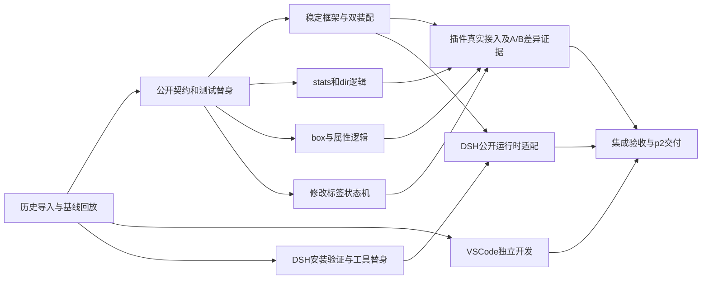

# 板块划分与开发路线

按模块交付，不按六名成员固定分配。一个板块可由两人结对，也可由同一小组负责两个低耦合板块。公共接口确定后，各板块依靠测试替身独立开发；合并时用真实装配做集成验证。

## 板块边界

| 板块             | 负责目录                                                                                   | 输入与对外契约                                                                                  | 独立完成条件                                                                             |
| ---------------- | ------------------------------------------------------------------------------------------ | ----------------------------------------------------------------------------------------------- | ---------------------------------------------------------------------------------------- |
| F 框架与宿主     | `packages/core/`、`packages/host/`、`packages/builtins/`、`packages/svg-xml/`、`apps/cli/` | 四扩展点、公开领域抽象、事务编辑服务、注册表、A/B装配、事件与编解码                             | 无可选插件仍通过 Phase 1 回归；通用测试插件证明扩展及失败回滚；发布契约清单              |
| C 命令插件       | `plugins/command-stats/`、`plugins/command-dir/`                                           | `Command`、文档只读视图、core 的 `DirectoryReader` 端口；真实 Node 适配器由框架阶段在 host 提供 | 不依赖内置命令表；替身测试及与真实适配器的集成测试；不改变历史；两个包可分别禁用         |
| B box 与属性语义 | `plugins/shape-box/`                                                                       | `ShapeProvider`、`AttributeHandler`、公开图形创建服务、容器能力、`TreeDecorator`                | 一个包提供 box、fill/label 处理器及 `(box)` 标签；克隆、读回、结构保护和事务测试独立通过 |
| T 修改标签       | `plugins/tree-modified/`                                                                   | `TreeDecorator`、只读文档视图、成功提交/保存/undo/redo 事件                                     | 独立状态机测试；不依赖 box；插件关闭时树输出无变化                                       |
| V VSCode 扩展    | `apps/vscode-svg/`；确有复用价值时参与 `packages/svg-xml/` 的公开解析契约                  | VSCode `FileDecorationProvider`、`DocumentSymbolProvider`、带源码范围的 XML 语法树              | 文件标记、层级、无 ID、源码定位、编辑刷新、不完整 XML；真实 Extension Host 演示和截图    |
| D DSH 插件       | `apps/dsh-plugin/`                                                                         | DSH 工具 API、公开 `EditorSessionPort`；集成适配器调用公开编辑运行时                            | 可安装/卸载、能检查 SVG 并按结构化参数生成流程图；替身测试和真实会话演示                 |
| Q 集成与交付     | `test/acceptance/`、`scripts/`、`.github/`、`doc/`、`docs/metrics/`                        | 需求矩阵、回放夹具、Git refs、CI日志、证据目录                                                  | 双装配逐字节一致、差异证明、指标脚本和报告、最终清单                                     |

Q 是各板块共同承担的工作，由一位集成协调者组织；测试与文档先由功能板块提交，避免所有材料留到最后由一人补写。框架板块可内部分成 core/事务、host/loader 两条任务线，但公开契约由同一份清单管理。

## 目标仓库布局

```text
svg-editor-platform/
  apps/
    cli/                 # REPL入口与代码装配组合根
    vscode-svg/          # VSCode扩展，独立打包
    dsh-plugin/          # DSH入口、配置、工具与运行时适配
  packages/
    core/                # 领域抽象、四扩展点、事务与公开服务
    host/                # 配置、动态解析、加载和暂存注册事务
    builtins/            # 默认命令、六种shape provider及实现
    svg-xml/             # XML语法树、位置与编解码适配
  plugins/
    command-stats/
    command-dir/         # 命令与替身测试；真实目录适配器在host
    shape-box/           # shape + attributes + (box) decorator
    tree-modified/
  test/
    acceptance/          # 跨包回归与集成
    fixtures/            # 固定SVG、目录夹具和故障插件
  doc/
    README.md
    transcript/          # 仅命令与注释的输入，预期输出单独存放
    adr/
    records/
    evidence/
    architecture/
  docs/metrics/          # 课程规定路径，脚本生成
  scripts/
  .github/
  AGENTS.md
  CONTRIBUTING.md
  package.json
  package-lock.json
  plugins.config.json
```

每个包自己的 `test/` 放单元和契约测试。包公开 API 由 `exports` 限制，禁止跨包通过相对路径访问 `src/`。普通叶子类型和分组类型的可复用抽象必须在 core 中公开；box 从注入的创建服务获得 rect/text，不导入 builtins 或其他插件。

## 并行开发与合并门槛



### M0 继承原仓库并固定基线

完整引入原历史、标签，确认 `final^{commit}`。在固定 Node/npm 环境运行原有检查，保留日志；把原规格、基础会话、手工分组流程图会话、期望输出及SVG分开存放。新增 CI 工作流之前先确认本地可以复现。规格与 final 不一致处单列 Issue。

产物：可复现基线、环境记录、导入记录、需求矩阵初版。此时 V 可独立实现，D 可验证最小 DSH 插件的安装和工具注册。

### M1 契约先行

框架组先提交四扩展点、插件 manifest、Command 元数据、注册事务、图形恢复/克隆/校验、文档提交事件和目录端口草案；为每块提供最小 fake context 和契约测试。接口评审后进入 `main`，插件板块才能依赖其开发。先确保编译与测试替身可用，不要求框架实现全部完成。

接口修改需用独立 Issue 说明影响范围，同时更新契约、替身、消费者和 ADR。工作区、TS 配置、根 lockfile 和构建入口的变更由集成协调者合入，其余板块避免并行改根配置。

### M2 框架可扩展并通过旧功能回归

把原实现逐步迁移到目标包。先接入默认六种图形和命令，再接入 XML、树装饰器管线、loader 的两种入口。用测试专用的通用虚拟插件验证未知类型可创建、克隆、序列化、读回并参与事务；不能等 box 接入后再补通用钩子。

产物：无可选插件的兼容日志、注册/激活失败测试、首版指标、扩展点实际调用位置。完成后建立共同框架基线分支 `evidence/p2-framework-base`，不打过程 tag。

### M3 插件板块独立交付并接入

C、B、T 各自提交测试与实现。由集成协调者在两个从共同框架基线产生的演示分支上，分别用 A 代码装配、B 配置装配接入同一份新插件。各自保留接入提交 `C_A/C_B` 和 `C^`，归档真实 diff 与运行日志；演示分支不依赖最终 main 的插件启用状态。

不要把插件初次加入、框架补洞、全部文档整理混在一个提交里。若发现公共契约不足，先回到框架 Issue 修复并更新共同基线，再重新建立演示提交。

### M4 三条产品线验收与文档收口

CLI 完成新增命令、box流程图、双标签、双装配、插件关闭兼容。单个插件接入的 C_A/C_B 差异证据与最终完整插件集的 A/B 回放分开保存：后者在同一集成提交、相同插件集合/顺序/options下执行基础、box、stats/dir全部会话，覆盖单个box演示分支没有启用的命令插件。

VSCode 完成实际运行证据；DSH 完成固定版本下真实安装和完整工具演示。VSIX和DSH安装产物必须包含或可安装全部运行依赖，在没有源码工作区链接的干净目录各安装运行一次。共享包可通过打包内嵌或正式依赖携带，不能依赖开发机上的workspace软链接。各功能板块补齐矩阵，Q 复查指标、依赖、证据引用和最终报告。

### M5 发布与课程交付

集成后的主分支验证通过，再把同一提交同步到原课程仓库。按任务书在最终提交打 `p2`，新旧仓库中的 `p2` 指向同一提交；`final` 保持原值。在提交前验证课程仓库地址、报告路径、tag和评阅访问权限。

未提供截止时间，因此使用完成条件驱动里程碑，不安排虚构日期。截止时间明确后再由团队给各里程碑填日期。

## DSH 插件的建议范围

建议实现一个“SVG 流程图助手”，复用本项目的领域能力，让智能体完成两类任务：

- `svg_inspect`：读取 SVG，返回画布、结构、类型统计与检查结果。
- `svg_create_flowchart`：接受经过 schema 校验的节点、标签、坐标和连接线，创建流程图并保存 SVG。

MVP 使用 rect/text/g/line 等默认图形能力，box 作为可选能力，DSH 不以 box 完成为开工条件。工具传递结构化数据并调用公开编辑服务，不解析 CLI 回显、不从模型文本直接拼接 shell 命令。结果返回路径、结构摘要和明确的错误信息；每次任务使用独立会话对象，避免文档状态串到其他会话。

先完成“最小插件能加载 → 用 fake EditorSessionPort 测逻辑 → 接真实运行时 → 安装卸载与真实会话”的闭环。接口和安装方式以固定 DSH 版本的官方文档为准。DSH 的 `apply(ctx)`/生命周期与本项目 CLI 的默认导出 `activate`/manifest 完全分开；本阶段不做自定义聊天 UI、额外模型平台或市场发布流程。

## 已建立的开发任务

22个开发Issue和一个总览Issue已按本路线创建，入口为 [任务索引](tasks/index.md) 和 [GitHub总览#23](https://github.com/zero0307/svg-editor-platform/issues/23)。开发范围、接口、验收和实际依赖都写在对应Issue中，认领与完成状态以GitHub为准。

起步可并行认领：#1 基线回放、#2 公开契约、#3 VSCode文件标记、#4 DSH最小加载。原初始化任务已完成，不重复创建待认领Issue。

#15是框架冻结门槛，依赖#14默认CLI迁移和#12首版指标；插件可在#2后先用fake开发，正式接入等待#15。#21的A/B证据准备可在框架冻结后先做，最终完整回放等待插件齐备，不等全部实现合main后才补造首次接入提交。

任务编号使用TASK-前缀，与验收需求ID分开。任务内容维护在 `doc/tasks/definitions.json`，编号对应维护在 `doc/tasks/github-issues.json`；范围或依赖变化同时更新实际Issue及原生blocked by关系。
