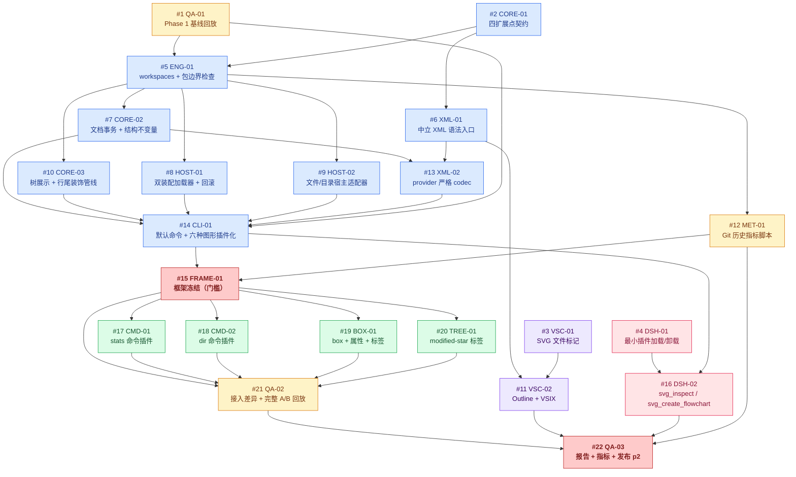

# 工程网络图（22 个开发任务依赖关系）

本图依据 [definitions.json](definitions.json) 的 `depends_on` 字段生成，节点为 `TASK-*` 任务，箭头 `A --> B` 表示"A 完成前 B 不能正式开始"。颜色按板块区分，红色为里程碑门槛。

- 无入边的节点为**可立即开工**的任务（`#1`、`#2`、`#3`、`#4`）。
- 唯一终点为 `#22 QA-03`（发布 p2）。
- 框架主线（甲+乙）为：`#2 → #5 → #7/#6/#8/#9/#10 → #13 → #14 → #15 → #21 → #22`。

## 图例

| 颜色       | 板块       | 任务                          |
| ---------- | ---------- | ----------------------------- |
| 蓝         | F 框架     | #2 #5 #6 #7 #8 #9 #10 #13 #14 |
| 黄         | Q 集成     | #1 #12 #21                    |
| 绿         | C/B/T 插件 | #17 #18 #19 #20               |
| 紫         | V VSCode   | #3 #11                        |
| 粉         | D DSH      | #4 #16                        |
| 红（加粗） | 里程碑门槛 | #15 框架冻结、#22 发布 p2     |

## 关键主线与两条独立产品线

- **框架主线（最长的依赖链，必须优先保障）**：`#2 → #5 → (#7/#10/#8/#9/#6) → #13 → #14 → #15 → #21 → #22`
- **VSCode 独立线**：`#3 → #11`（#11 额外依赖 #6 的 XML 语法入口）
- **DSH 独立线**：`#4 → #16`（#16 额外依赖 #14 的公开运行时）
- **插件组**：`#17/#18/#19/#20` 在 `#2` 契约出来后即可用 fake 并行开发，但正式接入统一卡在 `#15` 之后。
